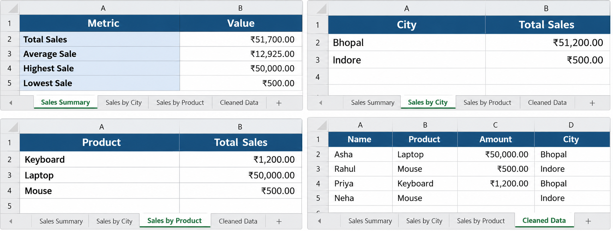

# Python CSV Cleaning & Sales Reporting Automation

## Overview
A Python automation tool that cleans messy CSV files, validates sales data, removes duplicate records, calculates sales statistics, and generates formatted Excel reports.

## Features
- Load CSV files by filename
- Validate required columns
- Detect invalid sales amounts
- Remove duplicate records
- Identify missing values
- Calculate total, average, highest, and lowest sales
- Generate sales reports by city and product
- Export formatted Excel workbooks

## Technologies
- Python
- Pandas
- OpenPyXL
- CSV
- Excel

## Installation
1. Clone or download this repository.
2. Install the required libraries:

   `pip install -r requirements.txt`

3. Place your input CSV file in the project folder.
4. Run the program:

   `python sales_automation.py`

5. Enter your CSV filename when prompted.

## Output
The program generates cleaned sales data and sales reports in CSV and Excel formats.

## Use Cases
Useful for small businesses and freelancers who need to clean sales data and prepare reports automatically.

## Excel Report Preview

The automation generates a formatted Excel workbook containing sales
statistics, sales by city, sales by product, and cleaned transaction data.

## Business Use Case

Businesses often receive CSV files containing duplicate transactions, inconsistent text formatting, missing values, and sales data that must be summarized manually.

This project automates the cleaning and reporting process using Python.

### Example Workflow

1. Provide a CSV file containing sales records.
2. Validate required columns and numeric sales amounts.
3. Clean whitespace and remove duplicate rows.
4. Calculate sales statistics and group sales by city and product.
5. Export cleaned data and a formatted Excel workbook.

### Business Benefits

- Reduces repetitive manual spreadsheet work.
- Makes sales data easier to review.
- Produces consistent reports.
- Helps identify invalid sales amounts for correction.

### Technologies Used

Python, Pandas, OpenPyXL, CSV, and Excel.
